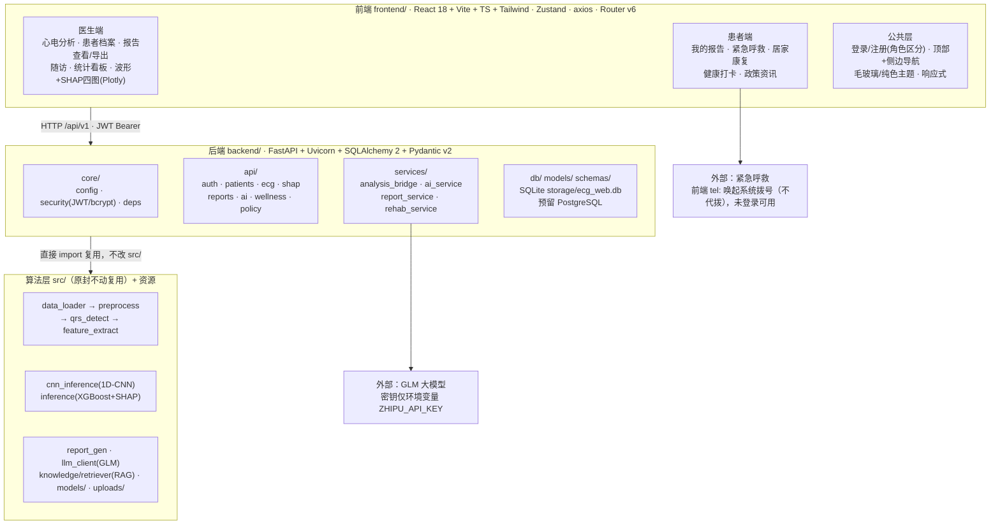

# AI护心镜——智慧康养心电风险筛查平台 · 重构技术方案

> 版本：v1.0　日期：2026-10-16
> 目标：将现有 Streamlit 单导联心电风险辅助筛查系统重构为「前后端分离」的产品级 Web 应用，并融合康养场景。
> 范围：不改动 `src/` 算法层，仅通过后端服务层包装复用；旧 Streamlit 代码保留至 `legacy/`。

---

## 一、现状盘点（2026-10-16 探查结论）

| 模块 | 状态 | 说明 |
| --- | --- | --- |
| 后端工程骨架 `backend/` | ✅ 批次1大部分完成 | FastAPI + SQLAlchemy + SQLite 已就位，`storage/ecg_web.db` 已生成 |
| 鉴权（JWT + bcrypt） | ✅ | `core/security.py`（python-jose + bcrypt），注册/登录/me |
| 患者档案 CRUD | ✅ | `api/patients.py`，含医生多患者管理、患者本人档案 |
| 心电分析 API | ✅ | `api/ecg.py`：analyze（上传+双通路推理一体）、列表、详情、波形、删除 |
| 数据迁移 | ✅ | `scripts/migrate_legacy_records.py`（旧 `ecg.db`/`records.json` → `ecg_records`） |
| 8 张业务表 ORM | ✅ | `models/`：users/patients/ecg_records/followups/emergency_contacts/health_checkins/rehab_plans/policy_articles 已定义 |
| 批次2 康养/报告/AI/SHAP 接口 | 🔲 未开始 | 见下方「缺口清单」 |
| 前端 `frontend/` | 🔲 完全缺失 | React 端需从零搭建 |
| 后端测试 | 🔲 缺失 | 仅遗留 `tests/test_demo_ecg.py`（旧算法），无 pytest/httpx 后端用例 |
| `backend/.env` | 🔲 缺失 | 需从 `.env.example` 复制并填入 `SECRET_KEY`、`ZHIPU_API_KEY` |

### 批次2 缺口清单（本次需补）
- SHAP 四图数据接口（summary / beeswarm / interaction / decision）
- 报告查看与导出（TXT + PDF）
- AI 接口（润色 polish / 诊断 diagnosis / 问答 ask）
- 康养接口：紧急联系人 CRUD、SOS、康复方案、健康打卡、随访、政策资讯
- 可选：`/ecg/upload`（当前 analyze 已含上传，若前端需分步上传再加）
- `backend/.env`、后端 pytest 用例、`main.py` 注册 wellness 路由

---

## 二、总体架构

> 本图为 Mermaid 图（支持 Mermaid 的 Markdown 查看器可直接渲染）；同内容另存为独立文件 `docs/架构图.html`，浏览器打开即可查看。



**外部集成说明**
- GLM 大模型（智能解读/润色/问答）——密钥仅走环境变量 `ZHIPU_API_KEY`，不写入代码。
- 紧急呼救——前端 `tel:手机号` 唤起系统拨号（不宣称代拨），未登录可通过 `device_key` 预存联系人触发。

### 部署形态（本地开发→上线）
1. **开发**：后端 `uvicorn app.main:app --reload --port 8000`；前端 `vite`（5173，CORS 已开）。
2. **上线**：`vite build` 产物由 FastAPI 静态托管（或 Nginx 反代 `/` → 前端、`/api/v1` → 后端），单机可跑。

---

## 三、目录结构（最终目标）

```
ECG-Auxiliary-Screening/
├── src/                    # 算法层（复用，不改动）
├── models/ uploads/ storage/ knowledge/ config/   # 复用
├── backend/                # FastAPI（已有骨架，续建批次2）
│   ├── app/
│   │   ├── main.py             # ✅ 已含 CORS + auth/patients/ecg/system
│   │   ├── core/               # ✅ config / security / deps
│   │   ├── db/                 # ✅ database（引擎/会话）
│   │   ├── models/             # ✅ 8 表 ORM
│   │   ├── schemas/            # ✅ auth/patient/ecg（需补 wellness/report/ai/sos）
│   │   ├── api/                # ✅ auth/patients/ecg/system（🔲 补 reports/ai/wellness/policy）
│   │   ├── services/           # ✅ analysis_bridge（🔲 补 ai/report/rehab/sos）
│   │   └── scripts/            # ✅ migrate_legacy_records
│   ├── tests/                  # 🔲 后端 pytest 用例
│   ├── .env                    # 🔲 复制 .env.example 并填密钥
│   └── requirements.txt        # ✅
├── frontend/               # 新增 React（从零）
│   ├── src/
│   │   ├── api/                # axios 封装（interceptor 注入 JWT）
│   │   ├── store/              # Zustand（auth / patient / record）
│   │   ├── components/         # 通用组件（导航、波形、SHAP图、上传等）
│   │   ├── pages/
│   │   │   ├── auth/           # 登录/注册（角色区分）
│   │   │   ├── doctor/         # 医生端
│   │   │   └── patient/        # 患者端（含公开 SOS 页）
│   │   └── routes/             # React Router v6 角色路由守卫
│   ├── package.json / vite.config.ts / tailwind.config.js
│   └── index.html
├── legacy/                 # ✅ 旧 Streamlit（app.py / service/ / database/）
└── docs/                   # ✅ 已有文档 + 本方案
```

---

## 四、数据库设计

**新表 8 张（ORM 已全部定义，`Base.metadata.create_all` 建表）**

| 表 | 用途 | 关键字段 / 关系 |
| --- | --- | --- |
| `users` | 医生/患者账号，`role` 区分 | username唯一、password_hash(bcrypt)、role(doctor/patient)、is_active；`patients` 双向关联 |
| `patients` | 患者档案 | `user_id`(绑定患者账号，可空)、`doctor_id`(主治医生)、name/gender/age/birth_date/height/weight/past_history/medication/note |
| `ecg_records` | 心电筛查记录（承接旧 records） | `record_id`(uuid, 与历史对齐)、`patient_id`、`doctor_id`、fs/total_beats/abnormal_beats、risk_level/risk_num/risk_score/risk_probs、features/r_peaks/abnormal_positions(JSON)、cnn_status/confidence、shap_result(JSON)、report_text/report_data、status、`waveform_path`(.npy 不入库) |
| `followups` | 随访提醒 | patient_id/doctor_id/ecg_record_id、due_date、status(pending/done/overdue)、content、completed_at |
| `emergency_contacts` | 紧急联系人 | patient_id(可空，支持未登录先加)、`device_key`(未登录设备标识)、name/relation/phone/is_primary |
| `health_checkins` | 每日健康打卡 | patient_id+checkin_date 唯一、symptoms/symptom_tags、heart_rate/blood_pressure/mood/note |
| `rehab_plans` | 居家康复方案 | patient_id/ecg_record_id、risk_level、exercise_type(八段锦/太极/慢走)、intensity/duration_min/frequency/guidance/cautions |
| `policy_articles` | 政策资讯 | title/category(康养/智慧养老/心脑血管防治)/source/source_url/published_at/summary/content/cover_image/is_published |

**复用旧数据迁移**
- `scripts/migrate_legacy_records.py`：旧 `storage/ecg.db.records` / `records.json` → `ecg_records`；按姓名重建档；迁移医生 `__migration_doctor__`（不可登录）。
- 旧 `legacy/database/` 与旧记录逻辑保留，不回改。

**切换 PostgreSQL**：仅改 `DATABASE_URL`（如 `postgresql+psycopg://...`），`database.py` 已按 sqlite 前缀自适应 `check_same_thread`。开发期 `init_db()` 建表，生产建议转 Alembic 迁移。

---

## 五、API 清单（前缀 `/api/v1`）

> ✅ = 已实现　🔲批次2 = 本次待实现　（详见批次计划）

### 鉴权
| 方法 | 路径 | 说明 | 状态 |
| --- | --- | --- | --- |
| POST | /auth/register | 注册（role 区分医生/患者） | ✅ |
| POST | /auth/login | 登录，返回 JWT | ✅ |
| GET | /auth/me | 当前用户 | ✅ |

### 患者档案
| 方法 | 路径 | 说明 | 状态 |
| --- | --- | --- | --- |
| GET | /patients | 医生：患者列表 | ✅ |
| POST | /patients | 医生：建档 | ✅ |
| GET | /patients/{id} | 详情（医生本人名下/患者本人） | ✅ |
| PATCH/PUT | /patients/{id} | 更新（现有为 PUT，前端按 PUT 对齐即可） | ✅ |
| DELETE | /patients/{id} | 删除 | ✅ |
| GET | /patients/me/profile | 患者本人档案 | ✅ |

### 心电分析
| 方法 | 路径 | 说明 | 状态 |
| --- | --- | --- | --- |
| POST | /ecg/analyze | 上传 + 双通路推理，结果落库 | ✅ |
| POST | /ecg/upload | 仅上传返回文件句柄（可选，前端需分步时补） | 🔲批次2可选 |
| GET | /ecg | 记录列表（角色收敛可见范围） | ✅ |
| GET | /ecg/{id} | 记录详情（特征/报告/SHAP） | ✅ |
| GET | /ecg/{id}/waveform | 清洗信号 + R峰 + 异常位置（前端绘波形） | ✅ |
| DELETE | /ecg/{id} | 删除记录 | ✅ |

### SHAP 四图（批次2）
| 方法 | 路径 | 说明 |
| --- | --- | --- |
| GET | /ecg/{id}/shap/summary | 全局特征重要性（条形图） |
| GET | /ecg/{id}/shap/beeswarm | 蜂群图数据 |
| GET | /ecg/{id}/shap/interaction | QRS×ST_shift 交互图 |
| GET | /ecg/{id}/shap/decision | 单样本决策力图 |

### 报告（批次2）
| 方法 | 路径 | 说明 |
| --- | --- | --- |
| GET | /reports/{record_id} | 报告详情（text + report_data + AI 解读） |
| GET | /reports/{record_id}/download?format=txt\|pdf | 导出 TXT / PDF |

### AI（批次2）
| 方法 | 路径 | 说明 |
| --- | --- | --- |
| POST | /ai/polish | 报告通俗润色 |
| POST | /ai/diagnosis | 结构化第二意见（JSON） |
| POST | /ai/ask | 心电/疾病知识问答（RAG + GLM） |

### 康养（批次2）
| 方法 | 路径 | 说明 |
| --- | --- | --- |
| GET/POST/DELETE | /emergency-contacts | 紧急联系人管理（未登录走 device_key） |
| POST | /emergency/sos | 触发紧急呼救（返回联系人，前端 `tel:` 唤起） |
| GET | /rehab/{patient_id} | 当前康复方案 |
| POST | /rehab/generate | 依据最新心电风险生成方案 |
| POST | /checkins | 提交健康打卡 |
| GET | /checkins/{patient_id} | 打卡历史 |
| GET/POST | /followups | 随访提醒列表/创建 |
| GET | /policy | 政策资讯列表 |

---

## 六、核心设计决策

1. **SHAP 四图数据源**：`src/inference.py` 已提供 `explain_shap_visualizations()`（返回 target_class/base_value/standardized_values/sample_contributions/global/interaction/decision）。当前 `analysis_bridge.analyze_file` 仅存单样本 `shap_result`，未接入四图数据。批次2 在 `analysis_bridge` 内追加调用 `explain_shap_visualizations` 并把结果存入 `ecg_records.shap_visualizations`（新增 JSON 列），四个 `/shap/*` 接口据此返回，前端用 Plotly 渲染。
2. **报告导出**：TXT = `record.report_text`；PDF 原计划复用 `src/report_gen.generate_pdf_report()`，实施时发现该函数依赖 `os/numpy/matplotlib/reportlab` 等**未在 src/report_gen.py 顶部导入**（直接调用会 NameError），受「不改 src/」约束，改由后端 `services/report_service.py` 用 reportlab + matplotlib **自绘 PDF**（含双通路结果表、波形图、12项特征、健康建议、免责声明），数据全部取自落库记录。
3. **AI 复用**：`src/llm_client.py` 已有 `polish_report_with_glm` / `generate_ai_diagnosis` / `answer_with_rag`（内部走 knowledge.retriever）。后端 `ai_service` 直接包装；`llm_client.py` 模块顶层 `import streamlit`，已按约定在后端 requirements 补 `streamlit`，密钥仅从 `ZHIPU_API_KEY` 环境变量读取。无密钥/调用失败时接口返回 `available=false` + 离线兜底，不抛 500。
4. **紧急呼救**：后端 `/emergency/sos` 仅返回匹配联系人与提示；**拨号动作由前端 `window.location.href = "tel:" + phone` 唤起系统电话**，不宣称系统代拨。未登录场景允许通过 `device_key` 预存联系人。
5. **康复推荐**：`/rehab/generate` 依据 `risk_level`（低危→八段锦/慢走，中危→太极拳低频，高危→仅静养+就医提示）+ 年龄/症状，生成 exercise_type/intensity/duration/frequency/guidance/cautions。
6. **政策资讯**：内置种子数据（民政部八部门文件、《健康中国行动—心脑血管疾病防治行动实施方案（2023—2030年）》、《智慧健康养老产业发展行动计划》等），前端导航栏入口展示。
7. **权限与数据隔离**：`core/deps` 已实现角色守卫；患者仅见本人档案/记录，医生仅见本人名下。紧急呼救页为公开页。
8. **密钥安全**：GLM 密钥仅存 `backend/.env` 的 `ZHIPU_API_KEY`，不入代码、不入库。
9. **数据库**：开发用 SQLite（`storage/ecg_web.db`），切换 PostgreSQL 仅改 `DATABASE_URL`。

---

## 七、批次实施计划与验收

> 每批完成即跑测试，问题立即修复，验收通过再进下一批。

### 批次1：后端核心（✅ 已完成）
- [x] FastAPI 骨架、SQLAlchemy ORM + SQLite、JWT 鉴权、患者 CRUD、心电分析、records 迁移
- [x] **收尾（已完成）**：`backend/.env` 落盘（SECRET_KEY 随机生成，ZHIPU_API_KEY 从根 .env 注入）；后端 pytest 冒烟用例（health/auth/patients/ecg 共7项）
- **验收结果**：✅ `uvicorn` 启动正常；`/api/v1/health` ok；注册→登录→建患者→上传心电→双通路分析落库 全链路跑通
- **额外修复关键 bug**：`core/config.py` 的 `BACKEND_DIR` 原本少退一级（指向 `backend/app`），导致模型目录错指 `backend/models`，XGBoost/CNN 静默回退到规则兜底；已改为 `Path(__file__).resolve().parents[2]`，现真实加载 `models/` 下模型

### 批次2：后端增强（✅ 已完成）
- [x] SHAP 四图数据接口（接入 `explain_shap_visualizations`，新增 `ecg_records.shap_visualizations` 列 + SQLite 幂等补列；partial 优雅降级）
- [x] 报告查看 + TXT/PDF 导出（后端 report_service 自绘 PDF）
- [x] AI 接口（polish / diagnosis / ask，包装 `llm_client`，无密钥优雅降级）
- [x] 紧急联系人 CRUD + SOS（device_key 支持未登录，SOS 返回 tel: 不代拨）
- [x] 健康打卡（同日 upsert）/ 康复方案（风险+年龄规则）/ 随访（创建/列表/完成）/ 政策资讯（3条种子，公开可读）
- **验收结果**：✅ 后端 pytest 全量 **22 passed / 0 failed / 0 error**；uvicorn 实启 33 条路由全部注册；真实 GLM 密钥连通验证通过

### 批次3：前端医生端（✅ 已完成）
- 工程初始化（React 19 + Vite 8 + TS + Tailwind v4 + shadcn/ui + Zustand + axios + React Router + Plotly.js + ECharts）
- 登录页 + 角色路由守卫 + 顶部/侧边导航
- 医生端：心电分析（上传/波形 Plotly/SHAP四图）、患者档案、报告查看导出、随访、统计看板（ECharts）
- 主题：医疗专业风（临床青绿主色），纯色/毛玻璃/磨砂可切换，响应式
- **验收**：✅ `npm run lint`（typecheck + eslint）**0 error**；前端 dev(31204) 经 vite proxy 联调后端(8000)，注册→登录→建患者→上传→真实模型分析→波形/SHAP四图/报告TXT+PDF/随访/列表 端到端全部通过（score=0.9589 与 Streamlit 版一致）。注：浏览器实机渲染因系统桌面授权未通过而未执行，已用静态检查 + dev 编译 + 全链路 API 验证替代。

### 批次4：前端患者端 + 部署
- 患者端：我的报告、紧急呼救（tel: 唤起）、居家康复、健康打卡、政策资讯
- 前后端联调、`vite build` + 静态托管/反代
- 部署脚本（启动后端 + 前端产物）
- **验收**：双端全流程联调通过；一键启动脚本可运行

---

## 八、风险与待确认

| 风险/事项 | 说明 | 处置 / 状态 |
| --- | --- | --- |
| `llm_client.py` 依赖 streamlit | 后端非 Streamlit 环境导入会失败 | ✅ requirements 已补 `streamlit`，实测导入与 GLM 调用正常 |
| SHAP 全局图依赖 `training_data.csv` | 缺文件时返回 partial（仅单样本/决策图） | ✅ 接口按 partial 返回 `available=false`+降级说明；当前环境训练数据存在，实测四图均 success |
| 模型路径推导 bug | `config.py` 的 BACKEND_DIR 少退一级，模型静默走规则兜底 | ✅ 已修复为 parents[2]，现真实加载 XGB/CNN |
| src PDF 函数缺顶层 import | `report_gen.generate_pdf_report` 直接调用会 NameError | ✅ 受「不改 src/」约束，后端 report_service 自绘 PDF |
| `/ecg/upload` 是否需要 | 现 analyze 已含上传 | 暂不加，批次3前端如需分步上传再补 |

---

## 九、批次1收尾 + 批次2 交付记录（2026-10-16）

**运行环境**：Python 3.11.9（`D:\Python3.11.9\python.exe`），依赖齐全（fastapi/uvicorn/sqlalchemy2/pydantic2/jose/bcrypt/streamlit/tensorflow/xgboost/shap/reportlab 等）。

**新增/修改文件**
- 新增：`backend/app/api/shap.py`、`reports.py`、`ai.py`、`wellness.py`、`policy.py`
- 新增：`backend/app/schemas/report.py`、`ai.py`、`wellness.py`
- 新增：`backend/app/services/report_service.py`、`ai_service.py`、`rehab_service.py`、`policy_seed.py`
- 修改：`core/config.py`（路径修复）、`core/deps.py`（可选鉴权）、`models/ecg_record.py`（新增列）、`db/database.py`（幂等补列）、`services/analysis_bridge.py`（接入四图）、`api/ecg.py`（存四图）、`main.py`（注册路由）、`requirements.txt`
- 配置：`backend/.env`（不入库）；测试：`backend/tests/`（conftest + 5 个测试文件，22 用例）

**测试**：`pytest tests` → 22 passed, 0 failed, 0 error, 0 skipped。真实数据样本 `uploads/100_30s.csv` 完成端到端分析。

**下一阶段（批次3）**：搭建 `frontend/` React 工程并实现医生端。当前前端目录仍为空。

---

## 十、批次3 交付记录（2026-10-16，前端医生端）

**技术栈**：基于妙搭官方 react-standard-webapp 脚手架（React 19 + Vite 8 + TypeScript + Tailwind v4 + 55 个 shadcn 组件），按需求额外安装 **Zustand / axios / react-plotly.js + plotly.js-dist-min**（ECharts 模板自带）。
> 说明：脚手架默认 React 19 + react-router-dom@7（v7 为 v6 的直接继任，路由 API 与 v6 完全兼容），为不破坏模板门禁与 shadcn 依赖，保留 19/7；用户点名的 Zustand / axios / Plotly 均已按要求安装使用。

**目录与新增文件**（`frontend/src/`）
- `api/`：`http.ts`（axios 实例 + JWT 拦截器 + 401 处理 + Blob 下载）、`auth/patients/ecg/reports/ai/wellness/policy.ts`、`index.ts` 聚合
- `store/`：`auth.ts`（Zustand 登录态 + localStorage 持久化）、`surface.ts`（纯色/毛玻璃/磨砂质感）
- `types/`：`index.ts`（与后端 Pydantic 对齐的实体类型 + 风险语义色 + 12 特征字典）、`plotly.d.ts`
- `routes/`：`RoleGuard.tsx`（登录+角色守卫）、`navItems.ts`（医生/患者导航）
- `components/`：`AppLayout`（顶部+侧边响应式导航）、`PlotlyChart`、`WaveformChart`、`ShapCharts`（四图 Tab + 优雅降级）、`AnalysisSummary`（双通路+12特征）、`RiskBadge`、`PageHeader`
- `pages/`：`auth/LoginPage`；`doctor/`（Analysis、Patients、Reports、ReportDetail、FollowUps、Dashboard + PatientFormDialog/FollowUpCreateDialog/AiInsightPanel）；`common/PolicyPage`；`patient/ComingSoon`（批次4占位，非死链）

**关键联调修正**
- 后端 `POST /auth/register` 实际返回 `UserOut`（**不含 token**），前端注册成功后改为自动调用 `/auth/login` 换取 JWT，已在 `store/auth.ts` 落地。
- `vite.config.ts` 增加 dev proxy：`/api` → `http://127.0.0.1:8000`（可用 `VITE_API_PROXY_TARGET` 覆盖）；dev 端口固定 **31204** 并同步 `spark.json`。
- 医疗主题色（临床青绿 + 风险语义色）写入 `tailwind-theme.css`；图表用 hex 字面量与主题 chart 色一致。

**测试结果**
- 静态检查 `npm run lint`（tsc + eslint）：**0 error**（仅 2 个未用变量 warning，不影响门禁）。
- 端到端冒烟（经前端 proxy）：注册/登录/me、建患者、上传 `100_30s.csv` 分析（**低危 score=0.958914、CNN=success、37 心拍、波形 10800 点/R峰37**）、SHAP 四图均 available、报告 has_shap、PDF 148KB 魔数 `%PDF-`、随访创建、患者/记录列表——**全部 PASS**。

**批次4 待做**：患者端四个实体页（我的报告 / 紧急呼救 tel: / 居家康复 / 健康打卡，当前为占位路由）、前后端联调收尾与部署脚本。
